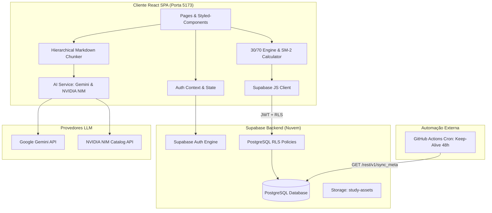

# Reestruturação SafeZone Studies: Supabase, NotebookLM MD, NVIDIA NIM e Método 30/70

* **Author:** Renato Lima / Equipe SafeZone Studies
* **Status:** Draft
* **Date:** 2026-11-12

--------------------------------------------------------------------------------

## Overview

O **SafeZone Studies** é uma aplicação web focada na preparação para certificações Microsoft Azure (**AI-200** e **AI-103**). Este documento projeta a reestruturação da infraestrutura e experiência de estudo do projeto a partir de quatro pilares essenciais:
1. **Migração completa para Supabase** (PostgreSQL na nuvem com autenticação, Row Level Security para isolamento estrito de dados multi-tenant, perfis com RBAC para administrador e automação externa de keep-alive a cada 48h para evitar a pausa de 72h do plano gratuito).
2. **Ingestão Semântica de Markdown (.md) do NotebookLM** (suporte a upload direto de arquivos `.md` e divisão hierárquica baseada em cabeçalhos `#`, `##`, `###` sem quebra de contexto).
3. **Substituição do OmniRoute pela API NVIDIA NIM** (remoção de código legado e suporte a modelos de alta capacidade como Llama 3.3 70B e DeepSeek R1 via endpoint compatível com OpenAI, mantendo Google Gemini como padrão).
4. **Metodologia de Estudo 30/70**:
   - **30% Teoria**: Leitura de apostila estruturada contendo resumo executivo, armadilhas clássicas da prova da Microsoft (*Exam Traps*) e matrizes comparativas de serviços.
   - **70% Prática Anki-Style**: Bateria de memorização ativa com flashcards tradicionais (flip) e questões simuladas de múltipla escolha com distratores justificados, ambos retroalimentados pelo algoritmo de repetição espaçada SuperMemo-2 (SM-2).

--------------------------------------------------------------------------------

## The Problem

A versão atual do SafeZone Studies opera isolada na máquina do usuário através de um servidor Node.js local (`server/index.mjs`) e banco SQLite (`data/safezone.db`), sem suporte a autenticação ou compartilhamento de materiais.
Isso impõe quatro barreiras fundamentais:
1. **Ausência de Autenticação e Multi-Tenancy**: Não há login nem diferenciação de papéis. O usuário não consegue convidar outros estudantes nem manter seus dados seguros e sincronizados entre dispositivos.
2. **Fragilidade na Ingestão de Conteúdo**: O fluxo dependia excessivamente de PDFs brutos e extração de texto via PDF.js (que falha frequentemente em formatação de colunas e tabelas). O estudante produz materiais consolidados no Google NotebookLM em `.md`, mas não tinha como injetá-los diretamente com preservação semântica.
3. **Provedor Legado e Obsoleto**: O projeto mantinha tipos e chamadas para o OmniRoute, serviço descontinuado para a operação pretendida.
4. **Estudo Focado Apenas em Flashcards Básicos**: O modelo anterior gerava quase exclusivamente cartões de pergunta e resposta curta, deixando de lado tanto a leitura aprofundada de armadilhas conceituais de prova quanto a prática em formato de simulado de múltipla escolha idêntico ao exigido pela Microsoft.

--------------------------------------------------------------------------------

## Goals

* **G1 (Autenticação e Multi-Tenancy)**: Implementar autenticação via Supabase Auth com Row Level Security (RLS) no PostgreSQL, garantindo que cada usuário veja e gerencie apenas seus próprios conteúdos, flashcards e estatísticas.
* **G2 (Papel de Administrador)**: Criar controle de acesso baseado em papéis (RBAC com `profiles.role`), permitindo que administradores visualizem o painel `/admin/users` e adicionem/convidem novos estudantes.
* **G3 (Garantia de Uptime Supabase)**: Implementar automação agendada via GitHub Actions (`.github/workflows/supabase-keepalive.yml`) executando a cada 48 horas contra a rota pública leve `/rest/v1/sync_meta` para impedir a inativação do Supabase gratuito.
* **G4 (Ingestão de Markdown do NotebookLM)**: Permitir upload e processamento direto de arquivos `.md` na tela `/biblioteca/novo`, particionando o texto semanticamente por seções de cabeçalhos (`#`, `##`, `###`).
* **G5 (Conector NVIDIA NIM)**: Expurgar o provedor OmniRoute de todo o codebase e integrar o conector oficial NVIDIA NIM (`https://integrate.api.nvidia.com/v1/chat/completions`), configurável via `/config`.
* **G6 (Motor de Aprendizagem 30/70)**:
  - Estruturar a apostila teórica com alertas de pegadinhas de prova e tabelas comparativas.
  - Oferecer simulador de questões de múltipla escolha com justificativa profunda dos distratores e avaliação de retenção integrada ao algoritmo SM-2.

--------------------------------------------------------------------------------

## Non-Goals

* **NG1 (Sincronização Offline Híbrida / CRDT)**: Não haverá sincronização bidirecional complexa offline-first com SQLite local. A aplicação conectará diretamente ao PostgreSQL do Supabase via client JS autenticado.
* **NG2 (Cobrança e Planos de Assinatura)**: Não haverá integração com Stripe ou gateways de pagamento; a adição de novos usuários será estritamente controlada pelo administrador.
* **NG3 (Motor Próprio de OCR de Imagens)**: O sistema não fará OCR de digitalizações; a entrada primária esperada para novos conteúdos de alta qualidade será o Markdown exportado do NotebookLM.

--------------------------------------------------------------------------------

## Open Questions

* **Q1**: Para o provisionamento de novos usuários pelo administrador, deve-se adotar chamada direta à Supabase Admin API (`auth.admin.createUser`) através do servidor Node com `service_role_key`, ou envio de e-mails de convite padrão (`auth.admin.inviteUserByEmail`)?
* **Q2**: Na resposta a questões de múltipla escolha, o erro deve atribuir nota 1 (`again`) no SM-2 automaticamente de forma imperativa, ou o estudante poderá ajustar manualmente sua percepção de esforço?

--------------------------------------------------------------------------------

## Critical User Journeys (CUJs)

### CUJ 1: Ingestão de Notas do NotebookLM e Geração 30/70
* **Given**: O usuário autenticado acessa a tela `/biblioteca/novo` e possui um arquivo `azure_ai_notes.md` exportado do NotebookLM.
* **When**: Arrasta o arquivo `.md` para a dropzone, seleciona o exame AI-200 e confirma a ingestão.
* **Then**: O sistema realiza o chunking semântico por cabeçalhos, dispara a IA (Gemini ou NVIDIA NIM) e gera tanto a apostila teórica (com armadilhas de prova e tabelas) quanto os flashcards e questões de múltipla escolha, persistindo todos no Supabase vinculados ao `user_id`.

### CUJ 2: Sessão de Estudo Guiada (Apostila + Questões SM-2)
* **Given**: O estudante possui uma sessão de estudo agendada com cartões e apostila pendentes.
* **When**: Inicia a sessão na rota `/estudo`.
* **Then**: O sistema apresenta primeiro a Fase 1 (Leitura da Apostila Teórica com callouts de pegadinhas). Ao concluir ou transbordar o tempo, entra na Fase 2 (Bateria de Questões Múltipla Escolha e Flashcards). Cada resposta é avaliada pelo algoritmo SM-2 e reagendada no banco para revisões futuras.

### CUJ 3: Administração e Provisionamento de Alunos
* **Given**: Um usuário logado com papel de `admin` acessa a rota `/admin/users`.
* **When**: Preenche o e-mail e dados de um novo estudante e clica em "Adicionar Usuário".
* **Then**: O sistema cria o perfil e credenciais do novo usuário, garantindo via RLS que ele tenha acesso exclusivo à sua própria biblioteca e sessões de estudo.

--------------------------------------------------------------------------------

## Technical Plan (Architecture)

### 1. Visão Arquitetural e Fluxo de Dados



### 2. Modelagem Relacional e Políticas de RLS (Supabase PostgreSQL)

#### 2.1 Esquema de Tabelas:
- **`public.profiles`**:
  - `id uuid primary key references auth.users on delete cascade`
  - `email text not null`
  - `role text not null default 'user' check (role in ('admin', 'user'))`
  - `full_name text`
  - `created_at timestamptz default now()`, `updated_at timestamptz default now()`
- **`public.contents`**:
  - `id uuid default gen_random_uuid() primary key`
  - `user_id uuid references public.profiles(id) on delete cascade not null`
  - `title text not null`
  - `type text not null check (type in ('pdf', 'link', 'text', 'markdown'))`
  - `source jsonb not null default '{}'::jsonb`
  - `tags text[] default '{}'`, `flashcards_count integer default 0`
  - `mastery real default 0`, `last_studied timestamptz`
  - `extracted_text text`, `chunks jsonb default '[]'::jsonb`, `study_guide jsonb default '[]'::jsonb`
- **`public.flashcards`**:
  - `id uuid default gen_random_uuid() primary key`
  - `user_id uuid references public.profiles(id) on delete cascade not null`
  - `content_id uuid references public.contents(id) on delete cascade not null`
  - `front text not null`, `back text not null`
  - `options jsonb`, `correct_answer text`, `explanation text`
  - `kind text default 'question' check (kind in ('theory', 'question'))`
  - `format text default 'flip' check (format in ('flip', 'multiple-choice'))`
  - `ease_factor real default 2.5`, `interval integer default 0`, `repetitions integer default 0`
  - `next_review timestamptz default now()`, `last_reviewed timestamptz`, `lapses integer default 0`
- **`public.study_sessions`**:
  - `id uuid default gen_random_uuid() primary key`
  - `user_id uuid references public.profiles(id) on delete cascade not null`
  - `date date default current_date`, `cards_reviewed integer default 0`
  - `cards_correct integer default 0`, `cards_again integer default 0`, `time_spent integer default 0`
- **`public.settings`**:
  - `user_id uuid references public.profiles(id) on delete cascade primary key`
  - `data jsonb not null default '{}'::jsonb`
- **`public.sync_meta`**:
  - `id text primary key`, `value text not null`, `updated_at timestamptz default now()`

#### 2.2 Triggers e Funções de Segurança:
- Trigger `on_auth_user_created`: Ao criar um usuário no Supabase Auth, insere automaticamente uma linha em `public.profiles` com papel `user` (ou `admin` se o e-mail corresponder ao do proprietário).
- Função `is_admin()`: Executa `select (role = 'admin') from public.profiles where id = auth.uid()` como segurança de apoio.

#### 2.3 Políticas de Row Level Security (RLS):
- Todas as tabelas habilitam RLS (`alter table ... enable row level security`).
- Política universal de leitura e mutação:
  ```sql
  create policy "Users manage own data" on public.contents
    for all using (auth.uid() = user_id or (select role from public.profiles where id = auth.uid()) = 'admin');
  ```
- Tabela `sync_meta`: Leitura anônima pública permitida para o ping de keep-alive (`create policy "Allow keepalive read" on public.sync_meta for select using (true)`).

### 3. Mecanismo de Ingestão Semântica de Markdown do NotebookLM

O novo módulo `src/services/markdownParser.ts` implementa o `HierarchicalMarkdownChunker`:
1. **Varredura Estrutural**: Identifica a hierarquia de títulos H1 (`#`), H2 (`##`) e H3 (`###`).
2. **Preservação de Contexto (Breadcrumbs)**: Cada bloco preserva o caminho completo do tópico (ex: `[AI-200 > Visão Computacional > Azure AI Custom Vision > Treinamento de Modelos]`).
3. **Limite de Tokenização Segura**: Blocos de texto que excedem 1.200 tokens são particionados em parágrafos respeitando pontuação final, sem cortar código ou tabelas no meio.
4. **Metadados de Chunks**: Cada chunk exporta `{ id, title, sectionBreadcrumb, content, tokenEstimate }`.

### 4. Pipeline de IA: Expulso OmniRoute e Entrada da API NVIDIA NIM

1. **Remoção de OmniRoute**:
   - Eliminação de types em `src/types/index.ts` (`omniroute`).
   - Remoção dos campos de endpoint e chave do OmniRoute em `src/pages/Configuracoes.tsx`.
2. **Conector NVIDIA NIM (`callNvidiaNIM`)**:
   - Endpoint padrão: `https://integrate.api.nvidia.com/v1/chat/completions`.
   - Headers: `Authorization: Bearer <NVIDIA_API_KEY>`, `Content-Type: application/json`.
   - Modelos recomendados: `meta/llama-3.3-70b-instruct`, `mistralai/mistral-large-2-instruct`, `deepseek-ai/deepseek-r1`.
   - Compatibilidade estrita com o payload da OpenAI (JSON schema estruturado para `studyGuide` e `flashcards`).
3. **Prompt de Engenharia Pedagógica (30/70)**:
   - Saída estruturada contendo:
     - `studyGuide`: Seções com `title`, `executiveSummary`, `gotchas` (armadilhas de prova da Microsoft) e `comparisonTable` (matriz de decisão com colunas de Cenário, Solução Recomendada e Por que descartar outras).
     - `flashcards`: Lista de itens contendo `format` ('flip' ou 'multiple-choice'). Para `multiple-choice`: `options` (4 alternativas), `correctAnswer` e `explanation` (justificativa de cada distrator).

### 5. Motor de Aprendizagem 30/70 e Algoritmo SM-2

1. **Fase 1 (30% Teoria Ativa)**:
   - Abertura de leitor dinâmico da apostila com navegação lateral por tópicos.
   - Componentes styled-components temáticos:
     - `ExamTrapCalloutStl`: Destaque em amarelo/laranja com ícone de alerta sobre pegadinhas conceituais do exame.
     - `DecisionMatrixStl`: Tabela comparativa interativa com realce de SKUs e limites operacionais.
   - Botão "Pronto para Praticar": Permite concluir a teoria e iniciar a fase de prática imediatamente.
2. **Fase 2 (70% Prática Anki + Múltipla Escolha)**:
   - Para cartões `format === 'flip'`: Exibição tradicional frente/verso, atalho `Espaço` para virar e notas 1–4 para autoavaliação.
   - Para cartões `format === 'multiple-choice'`:
     - Renderização de 4 alternativas (A, B, C, D).
     - Ao clicar na alternativa e confirmar, o sistema valida instantaneamente.
     - Feedback cromático: verde para a alternativa correta, vermelho para a alternativa incorreta escolhida.
     - Exibição de painel retrátil com a explicação detalhada de cada distrator.
     - Cálculo de repetição SM-2: em caso de acerto imediato, pré-seleciona nota `good` (4); em caso de erro, atribui nota `again` (1) reduzindo o fator de facilidade e reagendando a revisão no curto prazo.

### 6. Automação de Keep-Alive (Prevenção de Pausa do Supabase)

- Criação de workflow `.github/workflows/supabase-keepalive.yml`:
  ```yaml
  name: Supabase Keep-Alive Ping
  on:
    schedule:
      - cron: '0 4 */2 * *' # Executa a cada 48 horas às 04:00 UTC
    workflow_dispatch: # Permite disparo manual

  jobs:
    ping:
      runs-on: ubuntu-latest
      steps:
        - name: Ping Supabase REST API
          run: |
            curl -f -s -X GET "${{ secrets.SUPABASE_URL }}/rest/v1/sync_meta?select=id&limit=1" \
              -H "apikey: ${{ secrets.SUPABASE_ANON_KEY }}" \
              -H "Authorization: Bearer ${{ secrets.SUPABASE_ANON_KEY }}" || exit 1
  ```
- O job faz uma requisição read-only leve, mantendo o banco PostgreSQL do Supabase ativo sem consumir cotas de processamento ou memória.


--------------------------------------------------------------------------------

## Alternatives Considered

### Alternative A: Ping de Keep-Alive Local no Servidor Node.js
* **Pros**: Implementação simples com `setInterval` ou pacote `node-cron` dentro do backend `server/index.mjs` sem depender de serviços externos.
* **Cons**: Inoperante quando o computador local estiver desligado ou em modo de suspensão por mais de 72 horas. Nesse cenário, o ping não é enviado e o Supabase free tier pausa o projeto.
* **Reason for Rejection**: `Rejected by author: Não garante o uptime contínuo de 72h quando o usuário passa fins de semana ou períodos fora da máquina local. O GitHub Actions roda em nuvem com cron nativo e confiabilidade comprovada.`

### Alternative B: Sincronização Híbrida Offline-First (SQLite + Supabase)
* **Pros**: Possibilidade de estudar e revisar flashcards sem conexão com a internet.
* **Cons**: Enorme complexidade de sincronização bidirecional, detecção e resolução de conflitos (CRDT), duplicação de schema (SQLite local e PostgreSQL remoto) e inconsistência em múltiplos dispositivos.
* **Reason for Rejection**: `Rejected by author: Complexidade desproporcional para o escopo do projeto. A conexão direta do React com o Supabase simplifica radicalmente a base de código, tornando a persistência e a governança de dados limpas e confiáveis.`

### Alternative C: Flashcards Exclusivamente no Formato Tradicional (Flip Card)
* **Pros**: Mais fácil de gerar pela IA e interface mais simples.
* **Cons**: Não treina o estudante na habilidade essencial para os exames da Microsoft (AI-200 / AI-103), que é analisar cenários complexos de prova, identificar distratores plausíveis e selecionar entre opções A/B/C/D.
* **Reason for Rejection**: `Rejected by author: Os 70% de prática precisam refletir a realidade da certificação. O formato híbrido (flip para memorização de termos + múltipla escolha para cenários) entrega uma preparação incomparavelmente superior.`

--------------------------------------------------------------------------------

## Non-Functional Requirements

### Security & Privacy
* **Row Level Security (RLS)**: Cada linha de `contents`, `flashcards`, `study_sessions` e `settings` é estritamente isolada por `user_id = auth.uid()`. Nenhuma query do cliente pode vazar dados de outros usuários.
* **RBAC Administrativo**: Somente o perfil com `role = 'admin'` pode acessar a rota `/admin/users` e disparar chamadas administrativas.
* **Higiene de Chaves de IA**: As chaves do Google Gemini e da NVIDIA NIM são persistidas na tabela segura `settings` associada ao usuário autenticado, nunca hardcoded no código ou expostas no bundle público.

### Performance & Latency
* **Chunking Otimizado**: O particionamento de Markdown em blocos semânticos de até 1.200 tokens garante chamadas rápidas à API de IA, evitando timeouts e mantendo a latência de geração controlada.
* **Índices no PostgreSQL**: Criação de índices em `flashcards(user_id, next_review)` e `contents(user_id, created_at)` para carregamento instantâneo do dashboard e das sessões diárias.

### Rollout & Backward Compatibility
* **Script de Migração**: Criação de um script utilitário (`scripts/migrate-sqlite-to-supabase.mjs`) que permite exportar os dados do SQLite legado (`data/safezone.db`) e injetá-los no Supabase do usuário administrador, garantindo zero perda de histórico.


--------------------------------------------------------------------------------

## Detailed Implementation Plan

### 1. Unified Implementation Task List

1. **Fase 1: Infraestrutura & Autenticação Supabase**:
   - Adicionar dependência `@supabase/supabase-js` ao `package.json`.
   - Criar arquivo de migração SQL `supabase/migrations/20261112_init_schema.sql` com o DDL completo de todas as tabelas (`profiles`, `contents`, `flashcards`, `study_sessions`, `settings`, `sync_meta`), triggers de criação de perfil (`on_auth_user_created`) e políticas estritas de RLS.
   - Criar `src/services/supabaseClient.ts` com tipagem e tratamento de fallback para variáveis `VITE_SUPABASE_URL` e `VITE_SUPABASE_ANON_KEY`.
   - Implementar `src/context/AuthContext.tsx` e hook `useAuth()` para gerenciar sessão, login, cadastro e papel de usuário (`role`).
   - Criar tela de autenticação `src/pages/Login/index.tsx` estilizada com styled-components.
   - Proteger rotas no `src/routes/AppRoutes.tsx` com `ProtectedRoute` e criar rota restrita `/admin/users` vinculada a `src/pages/AdminUsers/index.tsx`.
   - Criar automação GitHub Actions `.github/workflows/supabase-keepalive.yml` agendada a cada 48h.

2. **Fase 2: Ingestão de Markdown do NotebookLM & Provedor NVIDIA NIM**:
   - Criar `src/services/markdownParser.ts` com o `HierarchicalMarkdownChunker` para fatiar notas preservando hierarquia de cabeçalhos (`#`, `##`, `###`) e breadcrumbs.
   - Atualizar `src/types/index.ts` para suportar `markdown`, perfil de usuário, novos campos de flashcards (`multiple-choice`, `options`, `correctAnswer`, `explanation`), seções de apostila com `gotchas` e matriz comparativa, e expurgo do `omniroute` com inclusão do `nvidia`.
   - Refatorar `src/services/aiService.ts`: remover OmniRoute, criar o conector oficial `callNvidiaNIM` (`https://integrate.api.nvidia.com/v1/chat/completions`) com suporte a modelos Llama 3.3 e DeepSeek R1, mantendo Gemini e OpenAI, e atualizar os prompts pedagógicos de geração 30/70.
   - Atualizar `src/pages/Configuracoes/index.tsx` para remover campos do OmniRoute e adicionar configuração de chave e modelo da NVIDIA NIM.
   - Atualizar `src/pages/NovoConteudo/index.tsx` para aceitar upload e dropzone de arquivos `.md`.

3. **Fase 3: Refatoração do Storage Client & Painel Administrativo**:
   - Refatorar `src/storage/index.ts` para consumir diretamente as tabelas do Supabase via client JS autenticado com RLS, eliminando dependência do banco SQLite para operações em nuvem.
   - Construir o painel `src/pages/AdminUsers/index.tsx` para listagem de estudantes, auditoria e convite/criação de novas contas.
   - Criar script utilitário `scripts/migrate-sqlite-to-supabase.mjs` para migração opcional dos dados legados locais para o Supabase.

4. **Fase 4: Motor e Interface de Estudo 30/70**:
   - Criar componentes visuais especializados: `src/components/study/ExamTrapCallout.tsx`, `src/components/study/DecisionMatrix.tsx` e `src/components/study/MultipleChoiceCard.tsx`.
   - Atualizar `src/hooks/useStudySession.ts` e `src/pages/EstudoDiario/index.tsx` para implementar a experiência bifásica: Fase 1 (Leitura teórica da apostila com armadilhas de prova) e Fase 2 (Prática híbrida com flashcards flip e simulador de questões de múltipla escolha com distratores justificados e notas SM-2).
   - Atualizar a documentação viva em `AGENTS.md` refletindo todas as mudanças estruturais, variáveis e rotas.
   - Executar validação com build, linter e testes Playwright.

---

### 2. Target Files to Create / Modify

#### Arquivos a Criar:
1. **`supabase/migrations/20261112_init_schema.sql`** (Create)
   - *Rationale*: DDL declarativo e versionado de todas as tabelas no PostgreSQL do Supabase, contendo triggers de espelhamento de `auth.users` em `public.profiles` e políticas universais de RLS.
2. **`src/services/supabaseClient.ts`** (Create)
   - *Rationale*: Ponto central de inicialização do `@supabase/supabase-js`, consumindo variáveis de ambiente e fornecendo a instância do cliente para toda a aplicação.
3. **`src/context/AuthContext.tsx`** (Create)
   - *Rationale*: Provedor de estado global de autenticação React, monitorando tokens JWT, status de login, permissões de `admin` e dados de perfil do usuário.
4. **`src/pages/Login/index.tsx`** (Create)
   - *Rationale*: Interface visual para login com e-mail e senha, recuperação de credenciais e feedback visual consistente com o tema do projeto.
5. **`src/pages/AdminUsers/index.tsx`** (Create)
   - *Rationale*: Painel administrativo para que o administrador gerencie e adicione estudantes com isolamento de dados.
6. **`src/services/markdownParser.ts`** (Create)
   - *Rationale*: Algoritmo semântico para leitura, limpeza e divisão hierárquica de arquivos `.md` originados do Google NotebookLM.
7. **`src/components/study/ExamTrapCallout.tsx`** (Create)
   - *Rationale*: Componente temático styled-components para destacar alertas de pegadinhas de prova da Microsoft na apostila.
8. **`src/components/study/DecisionMatrix.tsx`** (Create)
   - *Rationale*: Componente temático styled-components para renderização de tabelas e matrizes comparativas de decisão de serviços da Azure.
9. **`src/components/study/MultipleChoiceCard.tsx`** (Create)
   - *Rationale*: Componente de prática interativa de questões de múltipla escolha (A/B/C/D), com verificação de gabarito, revelação de distratores comentados e integração ao SM-2.
10. **`.github/workflows/supabase-keepalive.yml`** (Create)
    - *Rationale*: Automação cron do GitHub Actions para enviar pings regulares à API REST do Supabase a cada 48h, prevenindo a pausa de 72h do plano gratuito.
11. **`scripts/migrate-sqlite-to-supabase.mjs`** (Create)
    - *Rationale*: Script Node.js independente para migrar dados históricos do SQLite local para o Supabase sem perda de progresso.

#### Arquivos a Modificar:
1. **`package.json`** (Modify)
   - *Rationale*: Inclusão da biblioteca oficial `@supabase/supabase-js`.
2. **`src/types/index.ts`** (Modify)
   - *Rationale*: Atualização dos contratos TypeScript: adição de `Profile`, `UserRole`, formato `'markdown'`, expansão de `Flashcard` e `StudyGuideSection`, e remoção de `omniroute` em favor de `nvidia`.
3. **`src/services/aiService.ts`** (Modify)
   - *Rationale*: Implementação do conector NVIDIA NIM, remoção de OmniRoute e adaptação dos prompts para geração 30/70 estruturada.
4. **`src/storage/index.ts`** (Modify)
   - *Rationale*: Transição de chamadas HTTP locais `/api` para queries tipadas no Supabase com isolamento de dados via RLS.
5. **`src/hooks/useStudySession.ts`** (Modify)
   - *Rationale*: Adaptação do motor de repetição espaçada e fluxo da sessão para lidar com a fase teórica e a fase de questões de múltipla escolha.
6. **`src/routes/AppRoutes.tsx`** (Modify)
   - *Rationale*: Injeção das rotas `/login` e `/admin/users`, envolvendo rotas de estudo em guardas de autenticação.
7. **`src/pages/NovoConteudo/index.tsx`** (Modify)
   - *Rationale*: Suporte nativo a upload e drag-and-drop de arquivos Markdown do NotebookLM.
8. **`src/pages/EstudoDiario/index.tsx`** (Modify)
   - *Rationale*: Nova interface visual integrando leitura de apostila com callouts e simulador de questões de múltipla escolha.
9. **`src/pages/Configuracoes/index.tsx`** (Modify)
   - *Rationale*: Remoção de configurações do OmniRoute e adição dos seletores da NVIDIA NIM.
10. **`AGENTS.md`** (Modify)
    - *Rationale*: Atualização mandatória das regras arquiteturais, fluxos e modelos para refletir o ecossistema Supabase + NotebookLM + NVIDIA NIM + 30/70.

---

### 3. Verification Plan

* **Compilação e Tipagem**: `npm run build` executado via `tsc -b && vite build` sem nenhum erro de tipo TypeScript.
* **Qualidade e Linting**: `npm run lint` (Oxlint) limpo com 0 erros.
* **Análise de Grafo e Dependências**: `npm run graph:circular` (Madge) sem dependências circulares em `src/`.
* **Fluxo E2E Playwright**: Testes cobrindo:
  1. Carregamento da tela de login e proteção de rotas privadas.
  2. Ingestão de arquivo `.md` e geração de blocos 30/70.
  3. Sessão de estudo: transição entre Fase 1 (apostila) e Fase 2 (questão de múltipla escolha com cálculo de nota SM-2).
