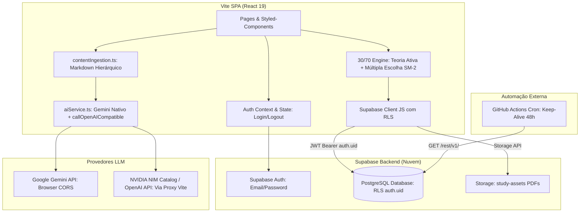

# Design Doc: Reestruturação SafeZone Studies (Supabase + NotebookLM MD + NVIDIA NIM + Método 30/70)

* **Author:** Renato Lima / Equipe SafeZone Studies
* **Status:** Finalized / Approved (Post EGM-Review Audit)
* **Date:** 2026-11-12
* **Target Spec:** `00-anything/01 - reestruturacao supabase md notebooklm 2026-11-12/reestruturacao_supabase_notebooklm_30_70.md`

--------------------------------------------------------------------------------

## Overview

O **SafeZone Studies** é uma aplicação web focada na preparação para certificações Microsoft Azure (**AI-200** e **AI-103**). Este documento consolida a arquitetura técnica para a reestruturação integral do projeto, aprovada após a execução do protocolo EGM-Review (Stages 5 a 9):
1. **Migração completa para Supabase** (PostgreSQL em nuvem, autenticação nativa por e-mail/senha, isolamento multi-tenant estrito por Row Level Security `auth.uid() = user_id`, Supabase Storage para arquivos e automação externa de keep-alive a cada 48h para prevenir a pausa de 72h do plano gratuito).
2. **Ingestão Semântica de Markdown (.md) do NotebookLM** (suporte a upload direto de arquivos `.md` e divisão hierárquica baseada em cabeçalhos `#`, `##`, `###` preservando breadcrumbs contextuais e sem quebra de código ou tabelas).
3. **Substituição do OmniRoute pela API NVIDIA NIM** (remoção de código legado, unificação com cliente OpenAI-compatible reutilizável para NVIDIA NIM e OpenAI, e manutenção do Google Gemini como opção nativa padrão com suporte pleno a CORS).
4. **Metodologia de Estudo 30/70**:
   - **30% Teoria**: Leitura de apostila estruturada contendo resumo executivo, armadilhas clássicas da prova da Microsoft (*Exam Traps*) e matrizes comparativas de serviços da Azure.
   - **70% Prática Anki-Style**: Bateria de memorização ativa com flashcards tradicionais (flip) e questões simuladas de múltipla escolha com distratores justificados, ambos retroalimentados pelo algoritmo de repetição espaçada SuperMemo-2 (SM-2: `again = 1`, `hard = 2`, `good = 3`, `easy = 4`).

--------------------------------------------------------------------------------

## The Problem

A versão anterior do SafeZone Studies operava de forma fragmentada na máquina local:
1. **Persistência Local e Falta de Sincronização**: O servidor Node.js local (`server/index.mjs`) e o banco SQLite (`data/safezone.db`) impediam o acesso entre diferentes computadores ou dispositivos móveis, sem autenticação de usuários.
2. **Fragilidade na Ingestão de Conteúdo**: O fluxo dependia excessivamente de PDFs brutos processados via PDF.js, propensos a perdas de layout e tabelas. O estudante gera materiais consolidados no Google NotebookLM em formato Markdown, mas não dispunha de entrada nativa estruturada.
3. **Provedor Obsoleto e Duplicação de IA**: Suporte residual ao OmniRoute descontinuado e falta de conector para a API da NVIDIA (NVIDIA NIM).
4. **Ausência de Questões Simuladas no Estudo**: O modelo anterior limitava-se a flashcards simples de memorização, sem simular o formato de prova da Microsoft (questões de múltipla escolha com análise detalhada de distratores).

--------------------------------------------------------------------------------

## Goals

* **G1 (Autenticação e Multi-Tenancy Supabase)**: Implementar autenticação via Supabase Auth com Row Level Security (RLS) no PostgreSQL, garantindo que cada usuário visualize e gerencie apenas seus próprios conteúdos, flashcards e sessões.
* **G2 (Gestão Enxuta de Usuários)**: Administrar acessos e convites de novos estudantes diretamente através do console web nativo do Supabase (Authentication > Users), mantendo o código frontend limpo e livre de complexidades de `service_role`.
* **G3 (Garantia de Uptime Supabase)**: Implementar automação agendada via GitHub Actions (`.github/workflows/supabase-keepalive.yml`) executando a cada 48 horas contra a rota REST leve `/rest/v1/` para impedir a inativação do Supabase gratuito.
* **G4 (Ingestão de Markdown do NotebookLM)**: Permitir upload e processamento direto de arquivos `.md` na tela `/biblioteca/novo`, particionando o texto semanticamente por seções de cabeçalhos (`#`, `##`, `###`) com estimativa de tokens leve (~4 caracteres por token).
* **G5 (Conector Unificado OpenAI-Compatible & NVIDIA NIM)**: Remover o provedor OmniRoute e criar cliente unificado compatível com a API da OpenAI em `src/services/aiService.ts`, suportando a NVIDIA NIM (`https://integrate.api.nvidia.com/v1`) com proxy reverso no Vite (`/api/nvidia`) contra bloqueios de CORS.
* **G6 (Motor de Aprendizagem 30/70)**:
  - Estruturar a apostila teórica com alertas de pegadinhas de prova (`ExamTrapCalloutStl`) e tabelas comparativas (`DecisionMatrixStl`).
  - Oferecer simulador de questões de múltipla escolha com justificativa dos distratores e avaliação de retenção integrada ao algoritmo SM-2 na escala nominal de 1 a 4.

--------------------------------------------------------------------------------

## Non-Goals

* **NG1 (Sincronização Offline Híbrida / CRDT)**: O SafeZone Studies torna-se uma SPA direta conectada ao Supabase; não haverá complexidade de concorrência ou sincronização offline com SQLite local.
* **NG2 (Cobrança e Assinaturas)**: Não haverá integração com gateways de pagamento externos; a liberação de contas é controlada pelo proprietário no Supabase.
* **NG3 (Painel Customizado de IAM no Frontend)**: Não haverá rotas nem telas administrativas para criação de credenciais de terceiros no React, evitando vazamento ou necessidade de `service_role_key`.

--------------------------------------------------------------------------------

## Critical User Journeys (CUJs)

### CUJ 1: Autenticação de Usuário e Isolamento de Dados
* **Given**: O usuário acessa a aplicação pela primeira vez.
* **When**: Acessa `/login` e informa e-mail e senha cadastrados previamente.
* **Then**: O Supabase Auth autentica a sessão, emite o JWT e redireciona o usuário para o `/` (Dashboard). Todas as consultas subsequentes ao PostgreSQL aplicam o filtro de RLS `auth.uid() = user_id`.

### CUJ 2: Ingestão de Notas do NotebookLM e Geração 30/70
* **Given**: O usuário autenticado acessa a tela `/biblioteca/novo` e possui um arquivo `azure_ai_notes.md` exportado do NotebookLM.
* **When**: Arrasta o arquivo `.md` para a dropzone, seleciona o exame (AI-200 / AI-103) e confirma a ingestão.
* **Then**: O sistema realiza o chunking hierárquico por títulos, aciona a IA (Gemini ou NVIDIA NIM) sequencialmente com teto seguro de 30 blocos e gera a apostila teórica (com armadilhas e tabelas) e os flashcards/questões de múltipla escolha, persistindo todos no Supabase.

### CUJ 3: Sessão de Estudo Guiada (Apostila + Questões SM-2)
* **Given**: O estudante possui uma sessão de estudo agendada com cartões e apostila pendentes.
* **When**: Inicia a sessão na rota `/estudo`.
* **Then**: O sistema apresenta primeiro a Fase 1 (Leitura da Apostila Teórica com callouts e tabelas comparativas). Ao clicar em "Pronto para Praticar", transita para a Fase 2 (Bateria de Questões Múltipla Escolha e Flashcards). Cada resposta é avaliada pelo algoritmo SM-2 (1: Novamente, 2: Difícil, 3: Bom, 4: Fácil) e reagendada no banco para revisões futuras.

--------------------------------------------------------------------------------

## Technical Plan (Architecture)

### 1. Visão Arquitetural



### 2. Modelagem Relacional e Políticas de RLS (Supabase PostgreSQL)

#### 2.1 Esquema de Tabelas (`supabase/migrations/20261112_init_schema.sql`):
```sql
-- Habilitar UUID
create extension if not exists "uuid-ossp";

-- Perfis de Usuário
create table public.profiles (
  id uuid references auth.users on delete cascade primary key,
  email text not null,
  full_name text,
  created_at timestamptz not null default now(),
  updated_at timestamptz not null default now()
);

alter table public.profiles enable row level security;
create policy "Users view own profile" on public.profiles for select using (auth.uid() = id);
create policy "Users update own profile" on public.profiles for update using (auth.uid() = id);

-- Trigger de criação automática de perfil
create or replace function public.handle_new_user()
returns trigger as $$
begin
  insert into public.profiles (id, email, full_name)
  values (new.id, new.email, new.raw_user_meta_data->>'full_name');
  return new;
end;
$$ language plpgsql security definer;

create or replace trigger on_auth_user_created
  after insert on auth.users
  for each row execute procedure public.handle_new_user();

-- Conteúdos
create table public.contents (
  id uuid default gen_random_uuid() primary key,
  user_id uuid references public.profiles(id) on delete cascade not null,
  title text not null,
  type text not null check (type in ('pdf', 'link', 'text', 'markdown')),
  source jsonb not null default '{}'::jsonb,
  tags text[] not null default '{}',
  flashcards_count integer not null default 0,
  reviewed_count integer not null default 0,
  mastery real not null default 0,
  last_studied timestamptz,
  created_at timestamptz not null default now(),
  updated_at timestamptz not null default now(),
  extracted_text text,
  chunks jsonb not null default '[]'::jsonb,
  study_guide jsonb not null default '[]'::jsonb
);

alter table public.contents enable row level security;
create policy "Users manage own contents" on public.contents for all using (auth.uid() = user_id);

-- Flashcards e Questões
create table public.flashcards (
  id uuid default gen_random_uuid() primary key,
  user_id uuid references public.profiles(id) on delete cascade not null,
  content_id uuid references public.contents(id) on delete cascade not null,
  front text not null,
  back text not null,
  format text not null default 'flip' check (format in ('flip', 'multiple-choice')),
  kind text not null default 'question' check (kind = 'question'),
  options jsonb, -- lista de MultipleChoiceOption
  explanation text, -- justificativa dos distratores
  ease_factor real not null default 2.5,
  interval integer not null default 0,
  repetitions integer not null default 0,
  next_review timestamptz not null default now(),
  last_reviewed timestamptz,
  lapses integer not null default 0,
  created_at timestamptz not null default now(),
  updated_at timestamptz not null default now()
);

alter table public.flashcards enable row level security;
create policy "Users manage own flashcards" on public.flashcards for all using (auth.uid() = user_id);

-- Sessões de Estudo
create table public.study_sessions (
  id uuid default gen_random_uuid() primary key,
  user_id uuid references public.profiles(id) on delete cascade not null,
  content_id uuid references public.contents(id) on delete set null,
  date date not null default current_date,
  cards_reviewed integer not null default 0,
  cards_correct integer not null default 0,
  cards_again integer not null default 0,
  time_spent_seconds integer not null default 0,
  started_at timestamptz not null default now(),
  completed_at timestamptz
);

alter table public.study_sessions enable row level security;
create policy "Users manage own sessions" on public.study_sessions for all using (auth.uid() = user_id);

-- Configurações de Usuário
create table public.settings (
  user_id uuid references public.profiles(id) on delete cascade primary key,
  data jsonb not null default '{}'::jsonb,
  updated_at timestamptz not null default now()
);

alter table public.settings enable row level security;
create policy "Users manage own settings" on public.settings for all using (auth.uid() = user_id);
```

### 3. Ingestão Semântica de Markdown em `contentIngestion.ts`

- A função `chunkMarkdownByHeadings(markdownText: string)` é adicionada diretamente a `src/services/contentIngestion.ts`.
- **Hierarquia Preservada**: Varredura de cabeçalhos `#`, `##` e `###` montando breadcrumbs (ex: `AI-200 > Visão Computacional > Custom Vision`).
- **Estimativa de Tokens**: Heurística leve `Math.ceil(chunkText.length / 4)`. Blocos com mais de 1.200 tokens são particionados em parágrafos duplos (`\n\n`) sem cortar código ou tabelas.
- **Fallback**: Caso não haja cabeçalhos no documento, aplica a quebra por parágrafos duplos automaticamente.

### 4. Provedores de IA: Unificação OpenAI-Compatible e Proxy Vite

- Em `src/services/aiService.ts`, remoção completa do código do OmniRoute e implementação de:
  ```typescript
  export async function callOpenAICompatible(config: {
    endpoint: string;
    apiKey: string;
    model: string;
    prompt: string;
    temperature?: number;
  }): Promise<string>;
  ```
- O Google Gemini continua como cliente padrão nativo direto no browser.
- Para chamadas à NVIDIA NIM, adiciona-se ao `vite.config.ts` o proxy reverso:
  ```typescript
  server: {
    proxy: {
      '/api/nvidia': {
        target: 'https://integrate.api.nvidia.com',
        changeOrigin: true,
        rewrite: (path) => path.replace(/^\/api\/nvidia/, ''),
      },
    },
  }
  ```

### 5. Motor de Estudo 30/70 e Algoritmo SM-2

- Em `src/hooks/useStudySession.ts`, introduz-se a máquina de estados:
  `currentPhase: 'reading' | 'practice' | 'finished'`.
- **Fase 1 (Apostila)**:
  - Exibe a apostila com componentes `ExamTrapCalloutStl` e `DecisionMatrixStl`.
  - O estudante conclui a leitura manualmente pelo botão "Pronto para Praticar".
- **Fase 2 (Prática)**:
  - Alterna entre cartões flip e cartões de múltipla escolha (`MultipleChoiceCard.tsx`).
  - No `MultipleChoiceCard`: seleção de A/B/C/D, verificação com feedback cromático imediato e exibição de justificativa dos distratores.
  - Se errar: atribui nota `again` (1) no SM-2 e reinsere a questão no fim da fila da sessão.
  - Se acertar: permite autoavaliação manual entre `hard` (2), `good` (3) e `easy` (4) para calcular o próximo intervalo com precisão.

### 6. Automação de Keep-Alive no GitHub Actions

- Arquivo `.github/workflows/supabase-keepalive.yml`:
  ```yaml
  name: Supabase Keep-Alive Ping
  on:
    schedule:
      - cron: '0 4 */2 * *' # A cada 48 horas
    workflow_dispatch:

  jobs:
    ping:
      runs-on: ubuntu-latest
      steps:
        - name: Ping Supabase REST
          run: |
            curl -f -s -X GET "${{ secrets.SUPABASE_URL }}/rest/v1/" \
              -H "apikey: ${{ secrets.SUPABASE_ANON_KEY }}" \
              -H "Authorization: Bearer ${{ secrets.SUPABASE_ANON_KEY }}" || exit 1
  ```

--------------------------------------------------------------------------------

## Detailed Implementation Plan

### 1. Fases de Execução

1. **Fase 1: Infraestrutura & Autenticação Supabase**:
   - Adicionar dependência `@supabase/supabase-js` e `@playwright/test` ao `package.json`.
   - Criar `playwright.config.ts` e script `"test:e2e": "playwright test"`.
   - Criar arquivo DDL `supabase/migrations/20261112_init_schema.sql`.
   - Criar `src/services/supabaseClient.ts` com validação de env vars.
   - Criar `src/context/AuthContext.tsx` e hook `useAuth()`.
   - Criar tela de login `src/pages/Login/index.tsx`.
   - Reorganizar `src/routes/AppRoutes.tsx` separando rota pública `/login` das rotas privadas no `MainLayout`.
   - Criar workflow `.github/workflows/supabase-keepalive.yml`.

2. **Fase 2: Ingestão de Markdown do NotebookLM & Conector NVIDIA NIM**:
   - Atualizar `src/services/contentIngestion.ts` com `chunkMarkdownByHeadings`.
   - Atualizar `src/types/index.ts` com os contratos completos de `Profile`, `MultipleChoiceOption`, `Flashcard` e `StudyGuideSection`.
   - Atualizar `src/services/aiService.ts` com `callOpenAICompatible`, remoção de OmniRoute e prompts pedagógicos 30/70.
   - Atualizar `vite.config.ts` com proxy reverso `/api/nvidia`.
   - Atualizar `src/pages/Configuracoes/index.tsx` com campos da NVIDIA NIM.
   - Atualizar `src/pages/NovoConteudo/index.tsx` para suporte a upload de arquivos `.md`.

3. **Fase 3: Refatoração do Storage Client & Aposentadoria de `server/index.mjs`**:
   - Refatorar `src/storage/index.ts` para consumir o cliente Supabase via queries tipadas.
   - Criar bucket de storage `study-assets` no Supabase e atualizar upload de arquivos.
   - Aposentar `server/index.mjs` e atualizar script `"dev": "vite"` no `package.json`.
   - Criar script utilitário `scripts/migrate-sqlite-to-supabase.mjs` com comando npm `"db:migrate-sqlite"`.

4. **Fase 4: Motor e Interface de Estudo 30/70**:
   - Criar componentes `src/components/study/ExamTrapCallout.tsx`, `src/components/study/DecisionMatrix.tsx` e `src/components/study/MultipleChoiceCard.tsx` adotando o sufixo `Stl`.
   - Atualizar `src/hooks/useStudySession.ts` e `src/pages/EstudoDiario/index.tsx` com o fluxo bifásico 30/70.
   - Atualizar `AGENTS.md` com a nova arquitetura e stack técnica.
   - Executar bateria de validações: `npm run build`, `npm run lint`, `npm run graph:circular` e `npx playwright test`.

---

### 2. Contratos TypeScript Exatos (`src/types/index.ts`)

```typescript
export interface Profile {
  id: string;
  email: string;
  fullName?: string;
  createdAt: string;
}

export type ContentType = 'pdf' | 'link' | 'text' | 'markdown';

export interface MultipleChoiceOption {
  id: string; // 'A', 'B', 'C', 'D'
  text: string;
  rationale: string;
  isCorrect: boolean;
}

export interface Flashcard {
  id: string;
  contentId: string;
  userId: string;
  front: string;
  back: string;
  format: 'flip' | 'multiple-choice';
  kind: 'question';
  options?: MultipleChoiceOption[];
  explanation?: string;
  easeFactor: number;
  interval: number;
  repetitions: number;
  nextReview: string;
  lastReviewed?: string;
  lapses: number;
}

export interface StudyGuideSection {
  id: string;
  title: string;
  content: string;
  executiveSummary?: string;
  gotchas?: string[];
  comparisonTable?: {
    title?: string;
    headers: string[];
    rows: string[][];
  };
}

export type AIProvider = 'gemini' | 'openai' | 'claude' | 'azure' | 'ollama' | 'nvidia';

export interface AIConfig {
  provider: AIProvider;
  apiKey: string;
  model: string;
  endpoint?: string;
}
```

---

### 3. Verification Plan

* **Compilação**: `npm run build` (`tsc -b && vite build`) com 0 erros de tipagem.
* **Linting**: `npm run lint` (Oxlint) com 0 erros.
* **Análise de Dependências**: `npm run graph:circular` (Madge) sem dependências circulares.
* **Testes E2E Playwright**: `npm run test:e2e` validando login, ingestão de markdown e execução de sessão 30/70.

--------------------------------------------------------------------------------

*Drafted with EGM — Reviewed and Approved*
